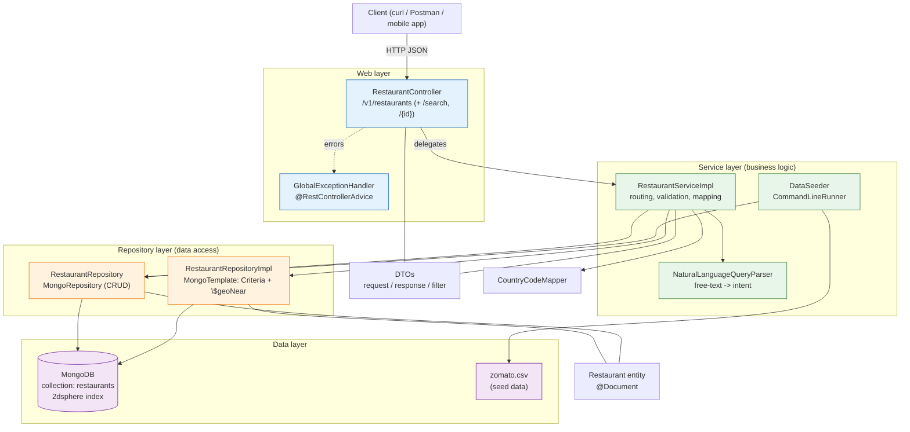
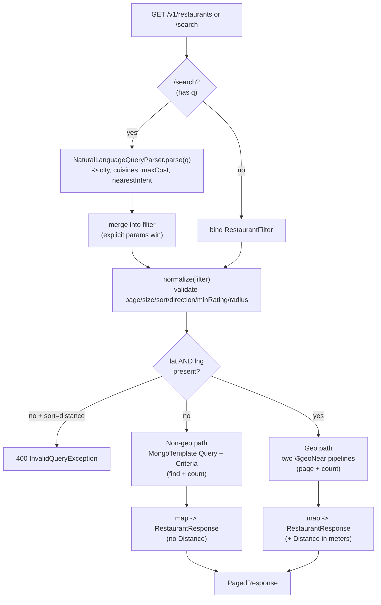
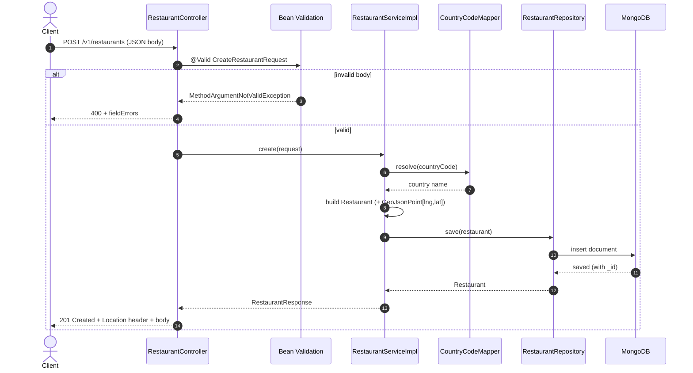
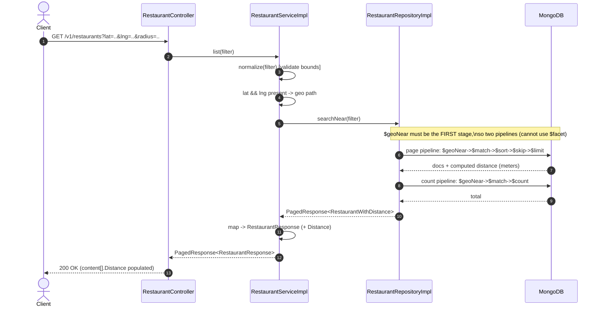
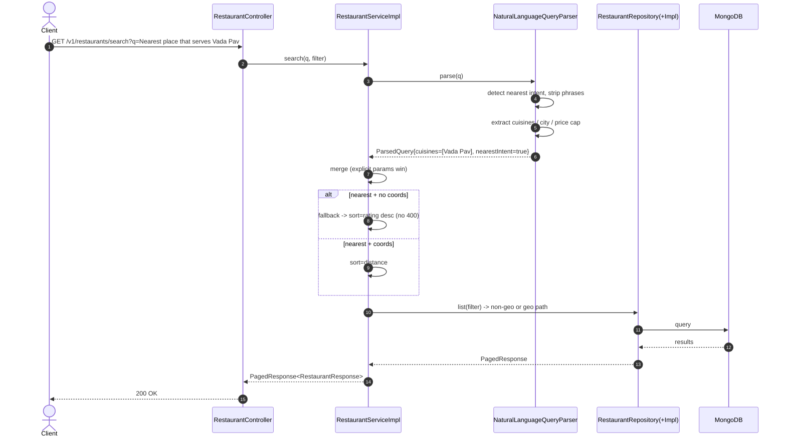
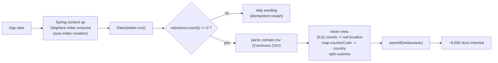
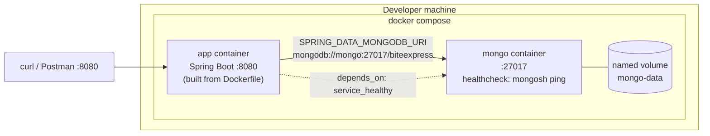
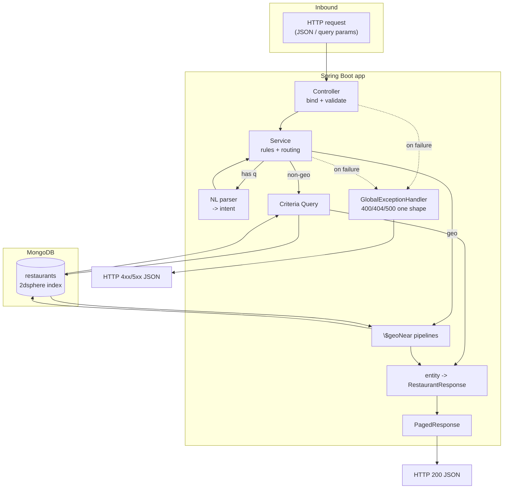

# BiteExpress — Project Overview & Walkthrough

A single document to understand, explain, and defend this project in a technical discussion.
It covers what the service does, how it is built, why each decision was made, the trade-offs,
and the questions a reviewer is likely to ask (with answers).

---

## 1. What this is, in one paragraph

BiteExpress is a backend REST API for **restaurant discovery**, built with **Spring Boot 3.4
(Java 21)** on top of **MongoDB**. It exposes four HTTP endpoints to create a restaurant, fetch
one by id, list restaurants with rich filtering/sorting/pagination (including geo-distance
search), and a `/search` endpoint that additionally understands plain-English queries like
"Best restaurants in Gurgaon with South Indian Food". On first start it seeds ~9,500 restaurants
from a Zomato CSV. The whole thing runs locally with one command via Docker Compose (app + MongoDB),
and ships with an automated test suite that runs against a real MongoDB using Testcontainers.

---

## 2. Technology choices and why

| Choice | Why |
|---|---|
| **MongoDB** | The data is document-shaped (a restaurant with nested location, a list of cuisines). Discovery queries are read-heavy, combinatorial, and need **geospatial** search. MongoDB's document model fits the entity naturally and its native `2dsphere` index + `$geoNear` make "restaurants near me, sorted by distance" a first-class query rather than something bolted on. |
| **Spring Boot + Spring Data MongoDB** | Fast, conventional, production-grade. `MongoRepository` for the simple CRUD, `MongoTemplate` for the dynamic/aggregation queries. Strong validation (`jakarta.validation`) and a clean controller/service/repository layering. |
| **Java 21** | Records for immutable DTOs, modern language ergonomics. |
| **Lombok** | Removes boilerplate (`@Data`, `@Builder`, `@RequiredArgsConstructor`) so the classes stay focused on intent. |
| **Apache Commons CSV** | Robust CSV parsing for the one-time data seed. |
| **Testcontainers** | Integration tests run against a **real MongoDB in a container**, so geo queries and aggregations are tested for real — not against a mock or an in-memory fake that behaves differently. |
| **Docker Compose** | One command brings up app + database with a persistent volume and a DB health check. Trivial to demo. |

**Why not a relational DB?** The scenario explicitly involves location-based discovery and
multi-valued fields (cuisines). In SQL, distance search needs PostGIS and cuisines need a join
table; in MongoDB both are native. Given the read-heavy discovery workload, Mongo is the better fit.
I can still explain how I'd model this relationally if asked.

---

## 3. Architecture — layers and flow

```
HTTP request
   │
   ▼
RestaurantController          (@RestController, /v1/restaurants, @Validated)
   │   binds + validates input, delegates. No business logic.
   ▼
RestaurantService (impl)      business rules: validation of query params,
   │   geo-vs-non-geo routing, NL-intent merge, DTO mapping
   ├── NaturalLanguageQueryParser    (free-text → structured intent)
   ▼
RestaurantRepository          MongoRepository (findById, save, count)
   └── RestaurantRepositoryCustom / ...Impl   (MongoTemplate: dynamic Criteria + $geoNear aggregation)
   │
   ▼
MongoDB (collection: "restaurants", 2dsphere index on location)
```

Supporting pieces:
- **DTOs** (`dto.request`, `dto.response`, `RestaurantFilter`) — the API contract, decoupled from the entity.
- **GlobalExceptionHandler** (`@RestControllerAdvice`) — one consistent JSON error shape for every failure.
- **CountryCodeMapper** — maps numeric country codes (e.g. `1 → India`) without an extra dependency.
- **DataSeeder** (`CommandLineRunner`) — one-time CSV ingest on an empty database.

**Design principle:** the controller is thin (bind/validate/delegate), the service owns the
business decisions, and the repository owns how data is fetched. Each layer is independently testable.

---

## 4. Data model

`Restaurant` is a MongoDB `@Document(collection = "restaurants")`. Key fields:

- `id` (String, Mongo `_id`) — the identity used by the API.
- `restaurantId` (Long) — the original business id from the dataset (kept, but **not** used as the API id).
- `name`, `city`, `address`, `locality`, `localityVerbose`.
- `countryCode` (Integer) and the resolved `country` (String).
- `location` — a **`GeoJsonPoint`** annotated `@GeoSpatialIndexed(GEO_2DSPHERE)`. Stored as `[longitude, latitude]` (GeoJSON order).
- `cuisines` (List<String>), `averageCostForTwo`, `currency`, `priceRange`.
- Flags: `hasTableBooking`, `hasOnlineDelivery`, `isDeliveringNow`.
- Ratings: `aggregateRating`, `ratingText`, `ratingColor`, `votes`.

**Two things to be ready to defend:**
1. **Coordinate order.** MongoDB GeoJSON is `[longitude, latitude]`, which is the *opposite* of how
   people usually say "lat, long". The code constructs `new GeoJsonPoint(longitude, latitude)`
   consistently in both the seeder and the create path. Getting this backwards is the classic geo bug.
2. **Id strategy.** The API id is the Mongo `_id` (a String/ObjectId), not `restaurantId`. This keeps
   identity owned by the datastore and avoids assuming the external id is unique/stable. `restaurantId`
   is retained and returned for traceability.

---

## 5. The four endpoints

Base path: `/v1/restaurants`.

### POST `/v1/restaurants` — create
- Body validated with `jakarta.validation` (see `CreateRestaurantRequest`): required fields, latitude
  in `[-90, 90]`, longitude in `[-180, 180]`, rating in `[0, 5]`, priceRange in `[1, 4]`, non-empty cuisines.
- Resolves `country` from `countryCode`, builds the `GeoJsonPoint`, saves, returns **201 Created** with a
  `Location` header and the created entity.

### GET `/v1/restaurants/{id}` — fetch one
- Looks up by Mongo id. Returns **200** or **404** (`RestaurantNotFoundException`) with the standard error body.

### GET `/v1/restaurants` — list (filter + sort + paginate + distance)
Query params bind to `RestaurantFilter`:
- **Filters:** `name` (case-insensitive substring), `city` (case-insensitive **exact**), `minRating`
  (`aggregateRating >=`), `cuisines` (repeatable; **ANY** match), `maxCostForTwo` (`averageCostForTwo <=`).
- **Distance:** when **both** `lat` and `lng` are present, the query switches to a geo path and each
  result carries a `Distance` field (**meters**). Optional `radius` (meters) caps the search.
- **Sort:** `sort` ∈ {`name`, `rating`, `distance`}, `direction` ∈ {`asc`, `desc`}. Defaults: rating-desc
  normally; distance-asc (nearest first) when coordinates are present.
- **Pagination:** `page` (0-based, default 0), `size` (default 20, hard cap 100).
- Returns a `PagedResponse` — `{ content, page, size, totalElements, totalPages }`.

### GET `/v1/restaurants/search` — everything above + natural language
- Required `q` free-text param, plus all the same structured params.
- `q` is parsed into intent (city, cuisines, price cap, "nearest"), merged into the filter, then the
  same listing machinery runs. **Explicit structured params win** over parsed values.

---

## 6. How distance search actually works (the interesting part)

When `lat` + `lng` are present, the repository runs a **MongoDB aggregation** built around `$geoNear`.
`$geoNear` **must be the first stage** of a pipeline (a hard MongoDB rule), which is why the code uses
**two separate pipelines** instead of a single `$facet`:

- **Page pipeline:** `$geoNear → $match → $sort → $skip → $limit` — returns the page of results, each
  annotated with a computed `distance` (meters, because `spherical: true`).
- **Count pipeline:** `$geoNear → $match → $count` — returns the total for pagination metadata.

Non-geo requests take a simpler path: a `MongoTemplate` `Query` built from dynamic `Criteria`, with
`Sort` + `skip/limit` and a separate `count`. One code path for "has coordinates", one for "doesn't".

**Why not `$facet` to get page + count in one round-trip?** Because `$geoNear` cannot be nested inside
`$facet` — it has to be stage one. Two pipelines is the correct, documented way. I accept one extra
round-trip to get an accurate total; if that ever mattered, I'd cache the count or drop exact totals.

**Why `$geoNear` and not `$near`/`$geoWithin`?** `$geoNear` both filters by distance **and returns the
computed distance** in one operation, which is exactly what the required response (`Distance`) needs.

---

## 7. Natural-language search — deliberately simple and local

`NaturalLanguageQueryParser` is **pure Java: regex + small static keyword sets, no LLM, no network, no
Atlas Search.** It extracts four things from `q`:

1. **Nearest intent** — `near me` / `nearby` / `nearest` / `closest`. Detected **first**, then those
   phrases are **stripped** from the text so the city regex can never capture "me" as a city.
2. **Cuisines** — matched against a known list; **multi-word entries are checked before single words**
   so "South Indian" isn't reduced to "Indian". ANY-match semantics.
3. **Price cap** — regex for `under Rs. 1000` / `under 1000` / `under ₹1000` → `maxCostForTwo`.
4. **City** — the token after `in`/`near`, cross-checked against a known-city set (unknown candidates
   still pass through as a best-effort filter).

**Graceful "nearest" fallback:** if the query says "nearest" but **no coordinates** are supplied, the
service does **not** error — it falls back to rating-desc and still applies the other filters. Rationale:
`/search` is a discovery convenience; "Nearest place that serves Vada Pav" should return something sensible.
(Contrast: an **explicit** `sort=distance` without coordinates **is** a 400 — explicit misuse is an error,
a soft NL hint degrades gracefully.)

**Why not a real NLP / LLM?** The requirement is a *locally runnable* MVP. A deterministic parser is fast,
free, testable, and offline. In the "defend it" section below I describe how I'd evolve this to **MongoDB
Atlas Search** (text + autocomplete) and then vector/semantic search for production — that's the natural
upgrade path, and the parser's output (structured intent) is exactly what would feed those.

---

## 8. Error handling

A single `@RestControllerAdvice` (`GlobalExceptionHandler`) produces one JSON shape for all errors:
`{ timestamp, status, error, message, path, fieldErrors? }`.

| Situation | HTTP |
|---|---|
| Not found (`RestaurantNotFoundException`) | 404 |
| Body validation (`MethodArgumentNotValidException`) | 400 + per-field errors |
| Param validation (`ConstraintViolationException`) | 400 + per-field errors |
| Bad query logic, e.g. `sort=distance` without coords (`InvalidQueryException`) | 400 |
| Wrong param type (`MethodArgumentTypeMismatchException`) | 400 |
| Anything uncaught | 500 (generic message, no internal leak) |

Query-param bounds (`page >= 0`, `size` cap, `minRating 0..5`, `radius > 0`) are enforced in the service's
`normalize(...)` so bad input returns a clean 400 instead of a 500.

---

## 9. Data seeding

`DataSeeder` is a `CommandLineRunner` that runs on startup. If the collection is empty it parses
`src/main/resources/zomato.csv` with Commons CSV and bulk-inserts. Notable cleanup during ingest
(the dataset needs it):
- Rows with coordinates `(0.0, 0.0)` get a **null** location (dirty-data guard) so they don't pollute geo results.
- `countryCode` is mapped to a human-readable `country`.
- `cuisines` is split into a list.
- Per-row parse failures are logged and skipped rather than aborting the whole seed.

It's **idempotent**: it only seeds when the DB is empty, so restarts don't duplicate data.

---

## 10. Testing

- **Integration tests** (`RestaurantControllerIT`, `RestaurantRepositoryIT`) run against a **real MongoDB**
  via Testcontainers (`@ServiceConnection` wires the container into Spring automatically). These exercise
  the real geo aggregation, filters, sorting, pagination, and the NL `/search` behavior end to end.
- **Unit tests** (`NaturalLanguageQueryParserTest`, `CountryCodeMapperTest`) cover the parser's rules
  (including "near me" → nearest intent / no bogus city) and the country mapping.
- Full suite: **61 tests**, run with `mvnw clean verify`.

**Why Testcontainers over a mock/embedded Mongo?** Geo queries and aggregation pipelines behave
differently (or not at all) on fakes. Testing against the real engine is the only way to trust that
`$geoNear` and the `2dsphere` index actually do what the code assumes.

---

## 11. Containerization & running it

- **Dockerfile** — multi-stage: build the fat jar with Maven, run it on a slim JRE image.
- **docker-compose.yml** — a `mongo` service (named volume for persistence + a `mongosh` health check)
  and the `app` service, which waits for Mongo to be healthy and connects via
  `SPRING_DATA_MONGODB_URI=mongodb://mongo:27017/biteexpress`.

Run the whole stack:
```
docker compose up --build        # app on http://localhost:8080, seeds ~9,500 rows on first boot
docker compose down              # stop (add -v to wipe the seeded data volume)
```
Local dev (DB in a container, app from the wrapper):
```
docker run -d -p 27017:27017 mongo
./mvnw spring-boot:run           # mvnw.cmd on Windows
```
Config: `spring.data.mongodb.uri` defaults to `mongodb://localhost:27017/biteexpress`, overridable by the
`SPRING_DATA_MONGODB_URI` env var. `auto-index-creation: true` ensures the `2dsphere` index exists at startup.


---

*This document describes the current state of the code in this repository. If the code changes, update
sections 4–11 accordingly.*


---

## 12. Project structure

Maven layout. Business code lives under `com.apextech.biteexpress`, split by responsibility.

```
biteexpress/
├── pom.xml                         # Maven build: Spring Boot 3.4, Java 21, deps, Testcontainers/docker-java pins
├── Dockerfile                      # multi-stage build (Maven build -> slim JRE runtime)
├── docker-compose.yml              # app + mongo (health check + persistent volume)
├── .dockerignore
├── README.md                       # how to run + API reference
├── PROJECT_OVERVIEW.md             # this document
├── postman/
│   ├── BiteExpress.postman_collection.json         # happy-path + boundary/error requests
│   └── BiteExpress.local.postman_environment.json  # baseUrl = http://localhost:8080
│
├── src/main/resources/
│   ├── application.yaml             # mongodb uri (env-overridable) + auto-index-creation
│   └── zomato.csv                   # seed dataset (~9,500 restaurants)
│
├── src/main/java/com/apextech/biteexpress/
│   ├── BiteexpressApplication.java          # Spring Boot entry point
│   │
│   ├── controller/
│   │   └── RestaurantController.java        # HTTP layer: 4 endpoints, bind + validate + delegate
│   │
│   ├── service/
│   │   ├── RestaurantService.java           # service interface (the contract)
│   │   ├── RestaurantServiceImpl.java       # business logic: routing, validation, NL merge, mapping
│   │   ├── NaturalLanguageQueryParser.java  # free-text -> structured intent (regex + keyword sets)
│   │   └── DataSeeder.java                   # CommandLineRunner: one-time CSV ingest (idempotent)
│   │
│   ├── repository/
│   │   ├── RestaurantRepository.java        # MongoRepository<Restaurant,String> + custom fragment
│   │   ├── RestaurantRepositoryCustom.java  # custom query contract (search / searchNear)
│   │   └── RestaurantRepositoryImpl.java     # MongoTemplate: dynamic Criteria + $geoNear aggregation
│   │
│   ├── model/
│   │   └── Restaurant.java                   # @Document, 2dsphere-indexed GeoJsonPoint
│   │
│   ├── dto/
│   │   ├── RestaurantFilter.java             # bound from list/search query params
│   │   ├── ParsedQuery.java                  # output of the NL parser
│   │   ├── RestaurantWithDistance.java       # entity + computed distance (geo path)
│   │   ├── request/
│   │   │   └── CreateRestaurantRequest.java  # validated POST body (jakarta.validation)
│   │   └── response/
│   │       ├── RestaurantResponse.java       # curated API response shape (JSON field names)
│   │       ├── PagedResponse.java            # {content, page, size, totalElements, totalPages}
│   │       └── ErrorResponse.java            # consistent error body
│   │
│   ├── exception/
│   │   ├── GlobalExceptionHandler.java       # @RestControllerAdvice: one error shape for all failures
│   │   ├── RestaurantNotFoundException.java  # -> 404
│   │   └── InvalidQueryException.java        # -> 400 (bad query logic)
│   │
│   └── util/
│       └── CountryCodeMapper.java            # countryCode (int) -> country name, no extra dependency
│
└── src/test/java/com/apextech/biteexpress/
    ├── RestaurantControllerIT.java           # API integration tests (Testcontainers Mongo)
    ├── RestaurantRepositoryIT.java           # repository/geo query integration tests
    ├── TestcontainersConfiguration.java      # MongoDBContainer bean (@ServiceConnection)
    ├── TestBiteexpressApplication.java        # local runner with Testcontainers
    ├── service/                               # NaturalLanguageQueryParserTest (unit)
    └── util/                                  # CountryCodeMapperTest (unit)
```

**Package responsibilities at a glance**

| Package | Owns | Depends on |
|---|---|---|
| `controller` | HTTP contract, binding, validation triggering | `service`, `dto` |
| `service` | business rules, geo-vs-non-geo routing, NL merge, entity↔DTO mapping | `repository`, `dto`, `model`, `util` |
| `repository` | how data is fetched (CRUD + dynamic Criteria + `$geoNear`) | `model`, `dto` |
| `model` | the persisted document + its index | — |
| `dto` | request/response/filter shapes (API decoupled from entity) | — |
| `exception` | one consistent error response for every failure | `dto` |
| `util` | small pure helpers (country mapping) | — |


---

## 13. Diagrams — layers, request flows, sequences

All diagrams are Mermaid; they render in the Markdown preview and on GitHub.

### 13.1 Layered / component view (full project, layer-wise)



### 13.2 Request routing — which path a list/search takes



### 13.3 Sequence — POST /v1/restaurants (create)



### 13.4 Sequence — GET /v1/restaurants with distance (geo path)



### 13.5 Sequence — GET /v1/restaurants/search (natural language)



### 13.6 Startup & data seeding



### 13.7 Deployment (Docker Compose)



---

## 14. End-to-end data & control flow (one picture)


